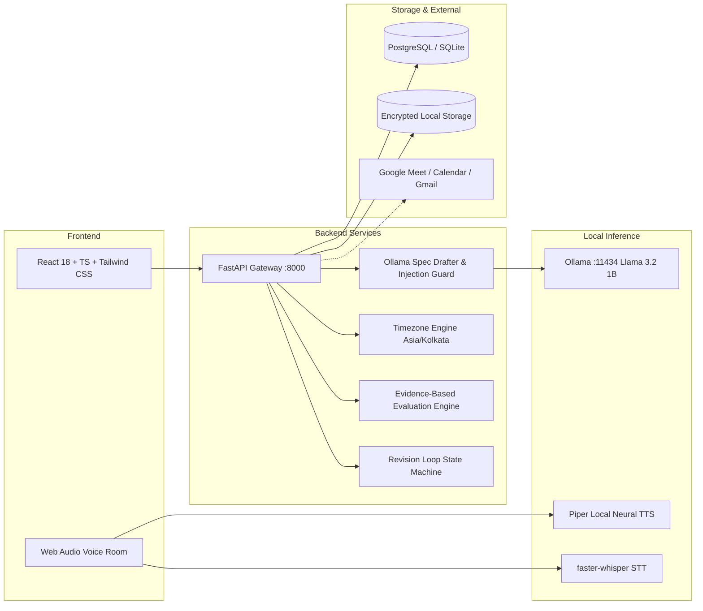

# Task Reviewer AI

**An internal enterprise platform that analyzes assignment briefs, conducts spoken voice briefings in natural Indian English, records and evaluates review meetings against objective rubrics, delivers feedback emails, and coordinates iterative revision cycles until deliverables pass acceptance criteria.**

---

## 1. Architectural Highlights & Strict Constraints

- **100% Free & Open-Source (FOSS)**: All core code, model inference, speech recognition, and audio synthesis run locally without paid APIs (no OpenAI, ElevenLabs, Deepgram, or Recall.ai).
- **CPU-Resident Local AI**: Powered by `llama3.2:1b` (1.3 GB Q4_K_M GGUF) via **Ollama**, optimized for host CPU memory constraints (~7.5–8.1 tokens/sec).
- **Local Speech Engines**: **Piper** local neural TTS for natural Indian-English speech synthesis ($RTF < 0.01\times$) and **faster-whisper** for on-device speech-to-text.
- **Google Meet & Offline Fallback**: Automated joining via headless Chromium with Virtual Audio Cable loopback, paired with a verified **Web Audio Voice Room** fallback featuring live waveform visualizers.
- **External Dependency Disclosure**: Google Meet, Google Calendar API, and Gmail API are disclosed as **proprietary external services**, provided with an offline dry-run mode that guarantees zero API dropouts.
- **Mandatory AI Disclosure & Consent Gating**: The agent transparently identifies itself as an **AI Task Reviewer**, provides pre-capture recording notices, and requires affirmative user consent before any audio capture or transcription begins.
- **Deterministic vs. Qualitative Evaluation**: Automated test assertions (e.g. pytest logs) and code repositories are verified deterministically, while meeting transcripts are evaluated qualitatively. Unverifiable evidence or disputed findings transition safely to `HUMAN_REVIEW_REQUIRED`.

---

## 2. System Architecture



---

## 3. Seed Accounts & Credentials

The database comes pre-seeded with synthetic accounts (Password: `SecretPass123!`):

| Role | Email Address | Capabilities |
| :--- | :--- | :--- |
| **Administrator** | `admin@internal.company` | System telemetry, model benchmarks, user creation, immutable audit trail, recording retention |
| **Task Assigner** | `assigner@internal.company` | Create tasks, upload briefs (PDF/DOCX), AI spec approval, calendar scheduling, evaluation engine |
| **Intern** | `intern@internal.company` | View assigned tasks, countdown deadlines (Asia/Kolkata), voice briefing, deliver submissions, appeals |

---

## 4. Quickstart Guide

### Option A: Native Local Development (Windows PowerShell)

#### Prerequisites
- Python 3.11+ (installed via uv or python.org)
- Node.js v20+ & npm
- Ollama running locally with `llama3.2:1b` pulled (`ollama pull llama3.2:1b`)

#### 1. Start Backend
```powershell
# In terminal 1:
.\scripts\run_backend.ps1
```
*Applies Alembic migrations, seeds accounts, and launches FastAPI on `http://127.0.0.1:8000`.*

#### 2. Start Frontend
```powershell
# In terminal 2:
.\scripts\run_frontend.ps1
```
*Launches Vite React SPA on `http://localhost:5173`.*

---

### Option B: Docker Compose Deployment

```bash
docker compose up --build
```
- Frontend UI: `http://localhost:3000`
- FastAPI Backend & Swagger Docs: `http://localhost:8000/docs`
- PostgreSQL: `localhost:5432`
- Local Ollama: `http://localhost:11434`

---

## 5. End-to-End User Flow

1. **Task Upload & AI Extraction**:
   - Assigner creates a task and uploads an assignment brief (`.pdf`, `.docx`, `.txt`).
   - The document is screened for prompt injections.
   - Assigner clicks **AI Spec Drafter**; local Ollama structures objective, deliverables, requirements, acceptance criteria, and rubrics.
   - Assigner reviews and approves the specification.
2. **Scheduling**:
   - Assigner schedules a Briefing or Review session with the `Asia/Kolkata` timezone engine.
   - A Google Meet URL or synthetic offline dry-run link is generated.
3. **Interactive Spoken Voice Briefing**:
   - Intern launches the **Interactive Voice Room**.
   - Mandatory AI disclosure and recording consent prompt is displayed; affirmative consent unlocks the microphone and activates the live Web Audio visualizer.
   - The AI Reviewer explains the task in natural spoken Indian English and answers questions from approved context.
4. **Deliverable Submission**:
   - Intern commits work to their Git repository and submits the URL, commit SHA, and test run logs via the Intern Portal.
5. **Evidence-Based Evaluation**:
   - Assigner clicks **Run AI Evidence Evaluation**.
   - Deterministic test logs are verified (zero failures pass; non-zero failures require revision).
   - Meeting transcripts are evaluated against concept rubrics with confidence scoring.
   - If tests fail $\rightarrow$ `REVISION_REQUIRED` with itemized action fixes and new deadline.
   - If tests pass $\rightarrow$ `PASS` and task is marked completed.
   - If disputed $\rightarrow$ Intern files an **Appeal**, routing directly to `HUMAN_REVIEW_REQUIRED`.

---

## 6. Verification & Test Suite

Run the complete backend automated test suite:

```powershell
.venv\Scripts\pytest backend/tests/ -v
```

**Results (100% Pass)**:
- `test_auth.py`: JWT login, password hashing, and role-based route protection.
- `test_task_lifecycle.py`: Document upload, injection filtering, AI extraction, and spec approval.
- `test_scheduling.py`: `Asia/Kolkata` timezone conversion, UTC normalization, and dry-run links.
- `test_security.py`: Prompt injection quarantine, path traversal blocks, unauthenticated request rejection.
- `test_evaluation.py`: Deterministic test parsing, qualitative rubric scoring, appeal routing, and pass assertion.

---

## 7. Documentation Index

- [docs/ENVIRONMENT_AUDIT.md](file:///d:/My%20Projects/AI-Task_Reviewer/docs/ENVIRONMENT_AUDIT.md): Host CPU, RAM, disk, and benchmark findings.
- [docs/ARCHITECTURE.md](file:///d:/My%20Projects/AI-Task_Reviewer/docs/ARCHITECTURE.md): Deep-dive architectural blueprints and component specifications.
- [docs/MEET_FEASIBILITY.md](file:///d:/My%20Projects/AI-Task_Reviewer/docs/MEET_FEASIBILITY.md): Google Meet bot evaluation, Vexa findings, audio loopback, and local room fallback.
- [docs/API_DOCUMENTATION.md](file:///d:/My%20Projects/AI-Task_Reviewer/docs/API_DOCUMENTATION.md): Complete OpenAPI REST endpoints and schemas.
- [docs/SECURITY_PRIVACY.md](file:///d:/My%20Projects/AI-Task_Reviewer/docs/SECURITY_PRIVACY.md): Consent gating, RBAC, injection mitigations, and data retention.
- [docs/GOOGLE_OAUTH_SETUP.md](file:///d:/My%20Projects/AI-Task_Reviewer/docs/GOOGLE_OAUTH_SETUP.md): Google Calendar & Gmail integration and offline dry-run mode.
- [docs/MODEL_LICENSES.md](file:///d:/My%20Projects/AI-Task_Reviewer/docs/MODEL_LICENSES.md): FOSS license verification for Ollama, Piper, faster-whisper, and dependencies.
- [docs/BUILD_STATUS.md](file:///d:/My%20Projects/AI-Task_Reviewer/docs/BUILD_STATUS.md): Milestone tracker and verification matrix.
- [docs/DECISIONS.md](file:///d:/My%20Projects/AI-Task_Reviewer/docs/DECISIONS.md): Architecture Decision Records (ADR 001 - 005).
