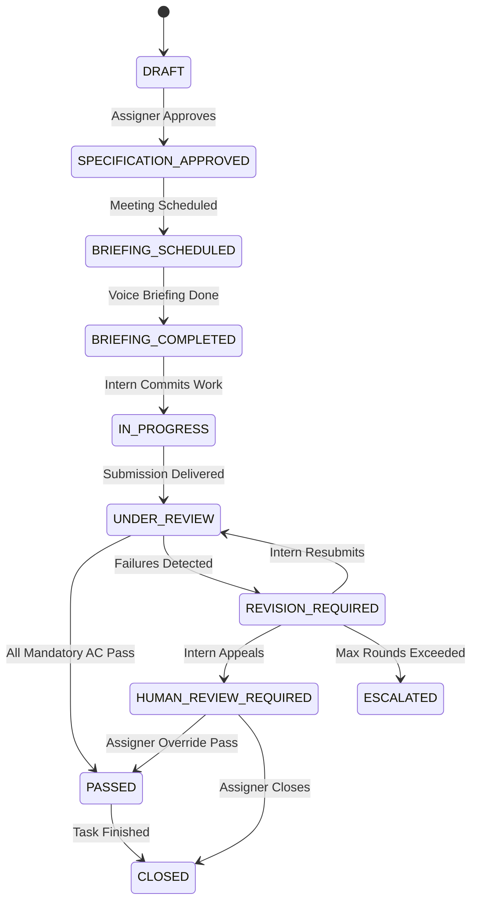

# System Architecture & Technical Specifications

## 1. Architectural Philosophy & FOSS Mandate

Task Reviewer AI is built as a high-performance, strictly local-first modular monolith. Every core processing element—from large language model inference to text extraction, deterministic test verification, speech recognition, and audio synthesis—operates on 100% free and open-source software (FOSS) running on local host hardware.

```mermaid
graph TD
    subgraph Client Layer
        Browser[React + TypeScript + Vite SPA]
        AudioRoom[Web Audio Voice Room]
    end

    subgraph API & Gateway
        FastAPI[FastAPI Modular Monolith :8000]
        AuthGuard[JWT Role-Based Auth Guard]
        Audit[Immutable Audit Logger]
    end

    subgraph Core Engines
        TaskIntel[Task Intelligence & Injection Defense]
        SchedEngine[Timezone Engine Asia/Kolkata]
        EvalEngine[Evidence-Based Evaluation Engine]
        RevMachine[Revision Loop State Machine]
        EmailGen[Transcript-Grounded Email Delivery]
    end

    subgraph Local Inference & Speech
        Ollama[Ollama Server :11434 Llama 3.2 1B]
        Piper[Piper Local TTS en_US / en_IN]
        Whisper[faster-whisper Local STT]
    end

    subgraph Data & Persistence
        DB[(PostgreSQL / SQLite aiosqlite)]
        Storage[(Local Encrypted Object Storage)]
    end

    subgraph External Proprietary Boundaries
        Meet[Google Meet External Dependency]
        Cal[Google Calendar API]
        Gmail[Gmail API]
    end

    Browser --> FastAPI
    AudioRoom --> Whisper
    AudioRoom --> Piper
    FastAPI --> AuthGuard
    FastAPI --> TaskIntel
    FastAPI --> SchedEngine
    FastAPI --> EvalEngine
    FastAPI --> RevMachine
    FastAPI --> Ollama
    FastAPI --> DB
    FastAPI --> Storage
    FastAPI -.-> Meet
    FastAPI -.-> Cal
    FastAPI -.-> Gmail
```

---

## 2. Component Subsystems

### 2.1 API & Modular Monolith Layer (`backend/app/api/v1/`)
- **`auth.py`**: Issues JWT Bearer tokens signed with HMAC-SHA256. Enforces role-based access control across `ADMIN`, `ASSIGNER`, and `INTERN`.
- **`tasks.py`**: Manages task creation, document ingestion, prompt injection scanning, AI specification drafting, and assigner approval.
- **`scheduling.py`**: Configures meeting schedules in `Asia/Kolkata` (UTC+05:30), creating Calendar events or synthetic dry-run links.
- **`meetings.py`**: Records meeting attempts, tracks transcript uploads, stores audio recordings, and checks consent compliance.
- **`submissions.py`**: Captures intern deliverables including Git repository URLs, commit SHAs, test run logs, and architectural notes.
- **`reviews.py`**: Executes deterministic test parsing and qualitative rubric evaluations, accepts intern appeals, and logs assigner overrides.
- **`health.py` & `benchmarks.py`**: Exposes real-time system metrics, RAM usage, database health, and live local model inference benchmarks.

---

### 2.2 Task Intelligence & Prompt Injection Defense (`backend/app/services/task_intelligence.py`)
Uploaded task briefs (PDF, DOCX, TXT) are treated as untrusted data, never executable instructions.
1. **Extraction**: Safe text parsing via `pypdf`, `python-docx`, or UTF-8 decoders.
2. **Heuristic Injection Scanning**: Scans for prompt override signatures (`"ignore all previous instructions"`, `"system prompt"`, `"jailbreak"`). If detected, flags the document with `has_detected_injection = True` and isolates the text.
3. **Structured Draft Extraction**: Prompts local Ollama (`llama3.2:1b`) using a strict JSON schema covering objective, scope, prerequisites, deliverables, requirements, acceptance criteria, and rubrics. If cold or unavailable, seamlessly falls back to a deterministic rule-based template.

---

### 2.3 Evidence-Based Evaluation Engine (`backend/app/services/evaluation_engine.py`)
Separates deterministic automated checks from qualitative model judgments:
- **`DETERMINISTIC_TEST`**: Analyzes automated test logs (e.g. pytest). Checks for passing tests (`"passed"`, `"ok"`, `"success"`) and accurately ignores zero-failure counts (`"0 failed"`). Non-zero failure counts trigger `FAIL`.
- **`ARTIFACT_INSPECTION`**: Inspects code repository availability, commit hashes, and sandbox execution logs. Rejects submissions with detected security violations.
- **`AI_JUDGMENT`**: Evaluates oral defense in meeting transcripts against rubric criteria concepts.
- **`HUMAN_AUDIT`**: Flags criteria for manual human assigner verification.

**Deterministic State Outcomes**:
- `PASS`: All mandatory criteria met, confidence score high, normalized score $\ge 70\%$.
- `REVISION_REQUIRED`: Any mandatory failure or normalized score $< 70\%$. Generates structured action items with recommended fixes and new deadlines.
- `HUMAN_REVIEW_REQUIRED`: Unverifiable evidence, missing test logs, low confidence, or active intern appeal.

---

### 2.4 Revision Loop State Machine (`backend/app/services/revision_loop.py`)

---

### 2.5 Audio & Speech Pipeline
1. **Speech-to-Text (STT)**: Locally runnable `faster-whisper` (OpenAI Whisper architecture transcribed using CTranslate2 on CPU with AVX2).
2. **Text-to-Speech (TTS)**: Locally runnable `Piper` synthesizing natural Indian-English speech (`en_US-libritts_r-medium` or `en_IN-cmu_indic`) with Real-Time Factor (RTF) $< 0.01\times$.
3. **Meeting Bot & Virtual Cable**:
   - Primary: Playwright headless Chromium automation joining Google Meet using Virtual Audio Cable (CABLE Input / CABLE Output) loopback with caption OCR.
   - Verified Fallback: Built-in Web Audio Voice Room running on local WebSocket with real-time waveform visualizer canvas and explicit consent gate.
